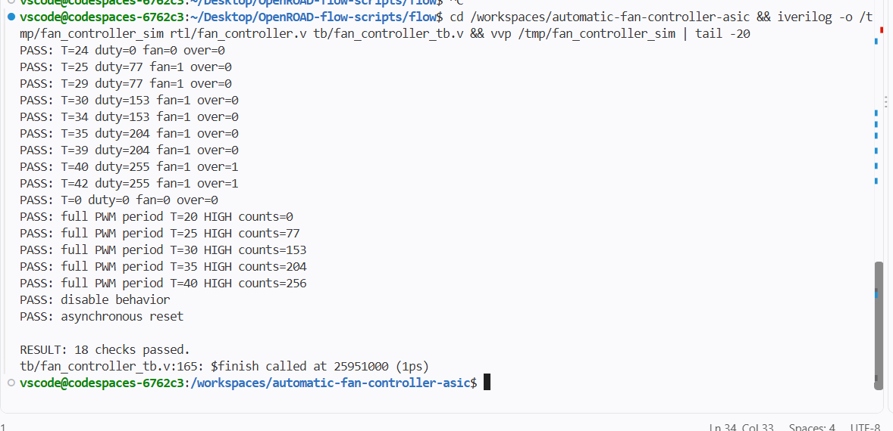
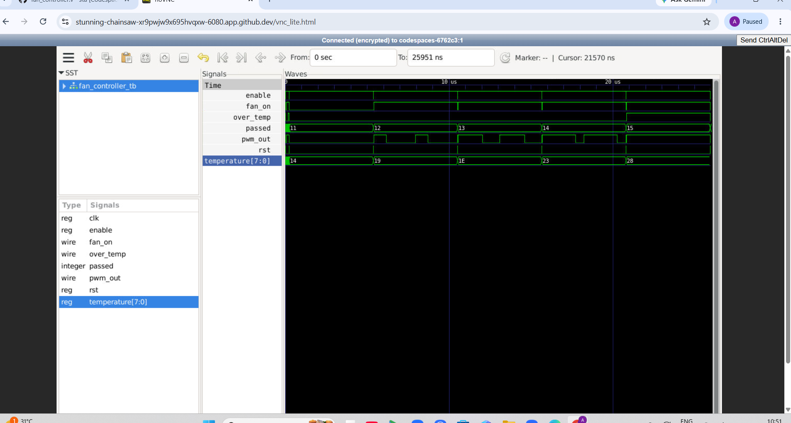
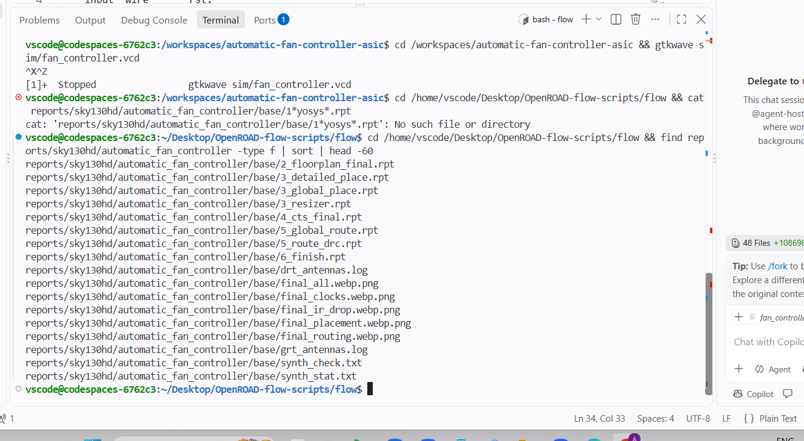
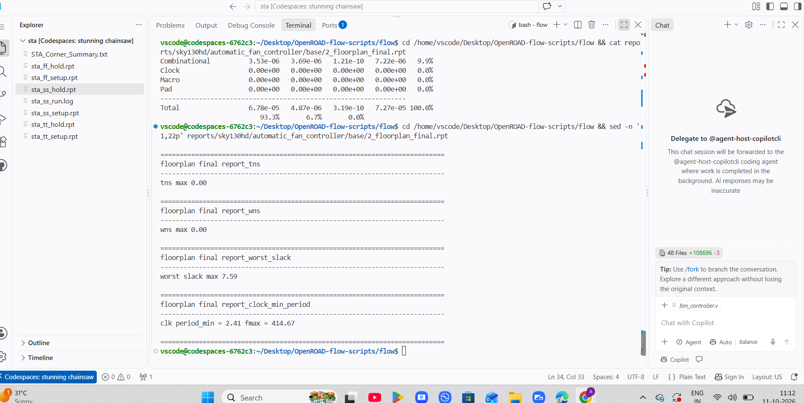
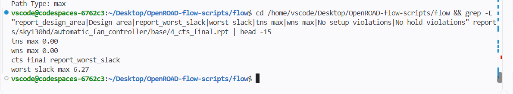
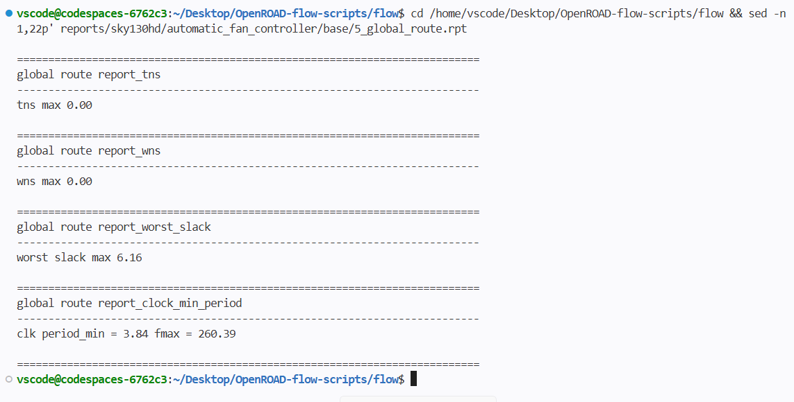
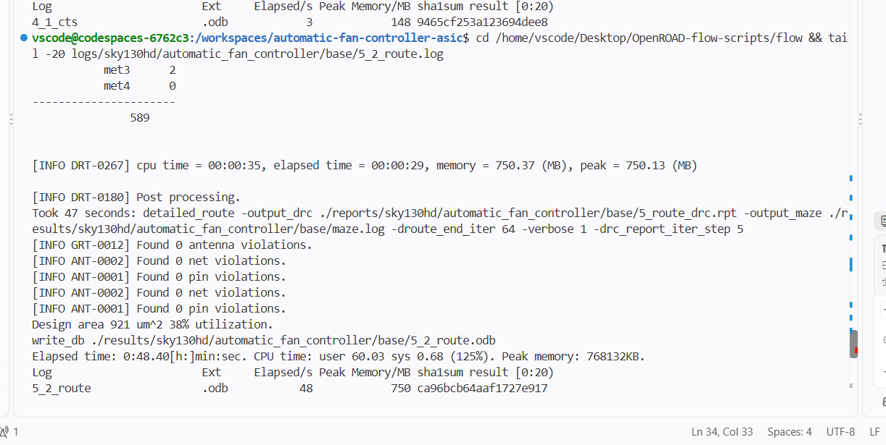
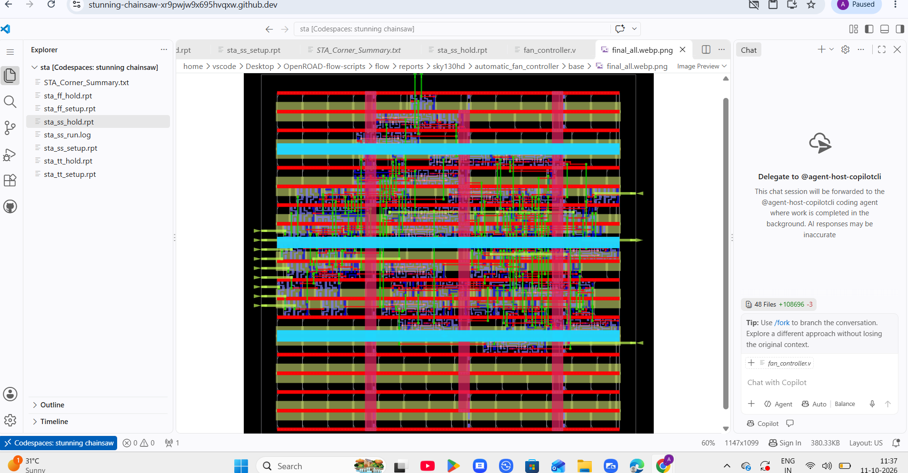
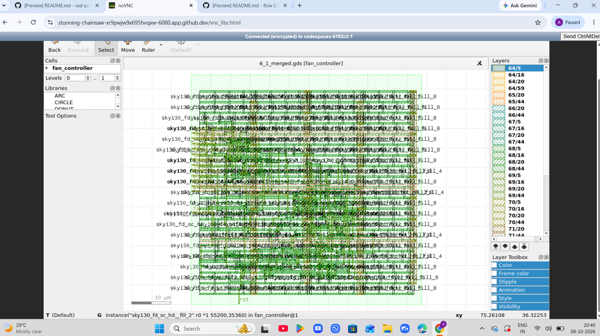
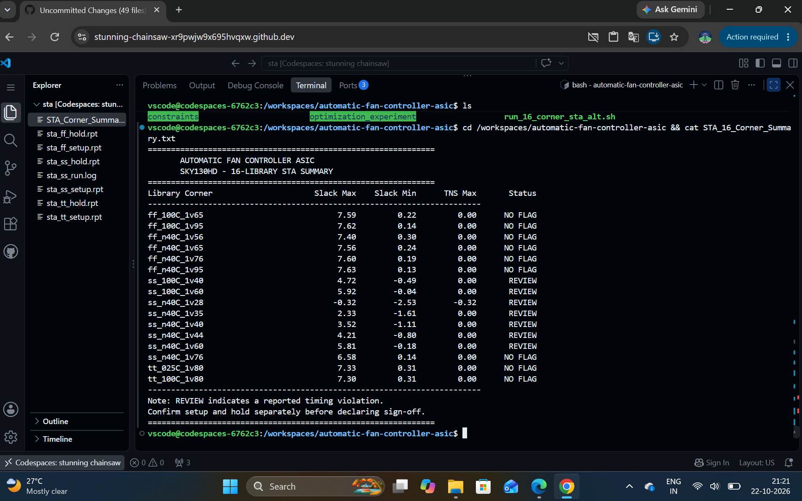

# Automatic Fan Controller ASIC

**Verilog RTL · SKY130HD · OpenROAD · Physical Design · 16-Corner Static Timing Analysis**

## 1. Project Overview

The Automatic Fan Controller ASIC is a Verilog-based digital controller that demonstrates temperature-dependent fan control and PWM generation. The RTL is checked with a testbench and then taken through an ASIC physical-design workflow using the SKY130HD standard-cell platform and OpenROAD.

This repository presents the RTL and testbench, timing constraints, selected physical-design reports, final implementation outputs, and screenshots documenting key stages.

## 2. Objectives

- Implement fan-control and PWM behavior in Verilog HDL.
- Verify the design using Icarus Verilog and inspect the waveform in GTKWave.
- Explore synthesis and the OpenROAD physical-design stages.
- Preserve selected reports and final layout-related outputs.
- Run static timing analysis across 16 library corners and report timing concerns transparently.

## 3. Tools and Technology

| Item | Tool / technology |
|---|---|
| RTL | Verilog HDL |
| Standard-cell platform | SKY130HD |
| RTL simulation | Icarus Verilog |
| Waveform inspection | GTKWave |
| Physical design | OpenROAD / OpenROAD-flow-scripts |
| Timing analysis | Static Timing Analysis (STA) |
| Layout output | GDSII |

## 4. Repository Structure

```text
Automatic-Fan-Controller-ASIC/
├── README.md
├── .gitignore
├── RTL/
│   ├── fan_controller.v
│   └── fan_controller_tb.v
├── Constraints/
│   └── constraint.sdc
├── STA_Reports/
│   ├── STA_16_Corner_Summary.txt
│   ├── STA_Corner_Summary.csv
│   ├── multi_corner_sta_before_optimization.log
│   ├── multi_corner_sta_after_optimization.log
│   ├── run_16_corner_sta.sh
│   ├── run_16_corner_sta.tcl
│   ├── run_16_corner_sta_alt.sh
│   └── run_16_corner_sta_experiment.sh
├── OpenROAD/
│   ├── 6_finish.rpt
│   ├── config_no_port_buffers.mk
│   ├── config_with_port_buffers.mk
│   ├── detailed_route.log
│   └── synth_stat.txt
├── Final_Outputs/
│   ├── 6_final.v
│   ├── 6_final.def
│   ├── 6_final.sdc
│   └── 6_1_merged.gds
└── Screenshots/
    ├── 02_Testbench_Pass.png
    ├── 03_PWM_Waveform.png
    ├── 04_Synthesis_Report.png
    ├── 05_Floorplan_Report.png
    ├── 07_CTS_Report.png
    ├── 08_Global_Route_Timing.png
    ├── 09_Detailed_Routing_DRC.png
    ├── 10_Final_Routed_Layout.png
    ├── 12A_STA_16_Corner_Summary.png
    └── 13_GDSII_Layout.png
```

*This tree documents the intended presentation structure. Keep only files that actually exist in the repository, and adjust names if your uploaded files differ.*

## 5. Functional Verification

### Run the testbench

From the repository root, run:

```bash
iverilog -o /tmp/fan_controller_sim RTL/fan_controller.v RTL/fan_controller_tb.v
vvp /tmp/fan_controller_sim
```

The recorded simulation run reports **18 checks passed**. The testbench output includes checks of temperature-dependent duty-cycle values, PWM-period behavior, disable behavior, and asynchronous reset. See the testbench for the exact assertions and scenarios.

### Testbench result



### PWM waveform



## 6. ASIC Physical-Design Flow

The selected evidence covers synthesis, floorplanning, clock-tree synthesis (CTS), global routing, detailed routing, and the final routed layout.

### Synthesis



### Floorplanning



### Clock-tree synthesis



### Global routing



### Detailed routing and DRC



The recorded detailed-routing log reports zero detailed-route violations and zero antenna, net, and pin violations for that run. This result alone does not establish complete manufacturing sign-off.

### Final routed layout



### GDSII layout view



## 7. Sixteen-Corner Static Timing Analysis

The project includes scripts and summary files for 16 SKY130HD library corners. Process, voltage, and temperature conditions affect cell and path delays.



**Timing status: review required.** The supplied summary marks multiple corners as `REVIEW`. It reports a worst `Slack Min` of **-2.53 ns** and a `Slack Max` of **-0.32 ns** for `ss_n40C_1v28`. Setup, hold, and reset recovery/removal checks must be assessed separately. Do not describe this result as fully timing-clean or sign-off complete.

## 8. Reproducibility

The simulation commands above require Icarus Verilog. The STA and physical-design scripts may depend on an installed OpenROAD-flow-scripts checkout and SKY130HD platform libraries; these external dependencies are not bundled here. Check the paths and tool versions in your environment before rerunning the flow.

## 9. Limitations and Future Work

- Investigate setup, hold, and reset-removal violations reported by the multi-corner analysis.
- Verify the timing constraints, libraries, and parasitic assumptions used by each run.
- Record exact tool versions and configuration files for reproducibility.
- Re-run STA after any approved RTL or implementation change.
- Complete applicable sign-off checks before making fabrication-readiness claims.

## 10. License

No license is specified in this repository. Add a license only if you have the right to distribute the project under its terms.

